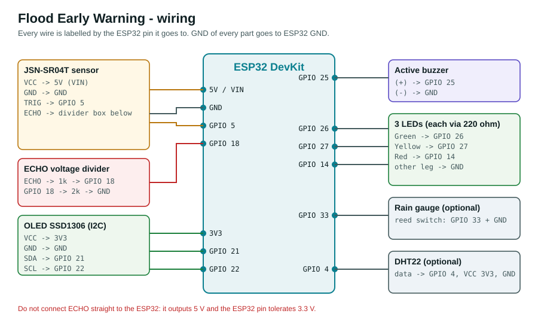

# Flood Early Warning System

ESP32 diye nodi/khal-er pani-r level mepe **Normal / Warning / Danger** alert dey. Local-e buzzer, LED ar OLED, ar internet-e live dashboard.

```
JSN-SR04T ultrasonic --> ESP32 --WiFi--> Firebase Realtime Database --> index.html (GitHub Pages)
                          |
                          +--> OLED + buzzer + 3 LED (local warning)
```



## Files
| File | Kaj |
|------|-----|
| `index.html` | Live dashboard. Demo mode-e hardware chhara-o cholbe |
| `esp32_flood_monitor.ino` | Main ESP32 code (WiFi + Firebase + alarm) |
| `esp32_sensor_test.ino` | Prothome eta chalaye sensor test koro |
| `wiring.svg` | Wiring chhobi |
| `test.json` | Firebase-e test data import korar jonno |

## 1. Dashboard online kora (GitHub Pages)
1. Repo-r **Settings -> Pages**.
2. Branch: **main**, folder: **/ (root)**, **Save**.
3. 1-2 minute por link: `https://USERNAME.github.io/REPO-NAME/`
4. Link kholo, **Live** chapo. Phone-eo ei link kaj kore.

Firebase URL `index.html`-er bhitore agei boshano ache. Onno URL dile dashboard-er **Settings** theke bodlao.

## 2. Firebase rules (khub joruri)
Firebase **test mode** 30 din por bondho hoye jay, tokhon ESP32 ar dashboard dui-i error dibe.
1. Firebase Console -> Realtime Database -> **Rules** tab.
2. Puro text muchhe eta boshao, **Publish**:
```json
{ "rules": { ".read": true, ".write": true } }
```
Prototype-er jonno thik. URL jane emon je keu data likhte pare, tai real deployment-e auth dite hobe.

## 3. Hardware list (~BDT 1,800-2,500)
| Component | Qty |
|-----------|-----|
| ESP32 DevKit (30/38 pin) | 1 |
| JSN-SR04T waterproof ultrasonic sensor | 1 |
| OLED SSD1306 0.96" I2C | 1 |
| Active buzzer 5V | 1 |
| LED red / yellow / green | 3 |
| Resistor 1k, 2k (1 ta kore), 220 ohm (3 ta) | 1 set |
| Breadboard + jumper wire | 1 set |
| 5V 2A adapter ba power bank | 1 |
| Waterproof plastic box | 1 |

Optional: tipping-bucket rain gauge, DHT22.

## 4. Component pele (ei order-e koro)
**Step A - sensor test**
1. Arduino IDE install koro. **Boards Manager** theke **esp32 by Espressif** install koro.
2. `esp32_sensor_test.ino` kholo. Arduino IDE "folder-e rakhte hobe" bolle **OK** chapo.
3. Wiring chhobi dekhe sensor joro. ECHO-te **1k + 2k divider** debei.
4. Board: **ESP32 Dev Module**, Upload, Serial Monitor **115200**. Haat sorale doori bodlale sensor thik.

**Step B - main code**
1. **Library Manager** theke **Adafruit SSD1306** ar **Adafruit GFX Library** install koro.
2. `esp32_flood_monitor.ino` kholo, ei tinta bodlao:
   - `WIFI_SSID`, `WIFI_PASS`
   - `SENSOR_HEIGHT_CM`: sensor theke nodir tola porjonto doori (cm)
   - `WARNING_M`, `DANGER_M` (dashboard Settings-er sathe same rakho)
3. Upload. OLED-te level dekhabe, Serial Monitor-e `level=...` likha ashbe.
4. Dashboard-e **Live** chapo.

**Bench test (nodi chhara):** sensor-ke upor theke baltir pani-r dike dhoro. `SENSOR_HEIGHT_CM = 60`, `WARNING_M = 0.3`, `DANGER_M = 0.4` dao. Balti-te pani barale Warning/Danger-e jabe ar buzzer bajbe.

## 5. Dashboard-er state
| Dashboard-e dekhay | Mane |
|--------------------|------|
| LIVE (sobuj) | ESP32 notun data pathachhe |
| OFFLINE | 2 minute dhore notun data nei: power ba WiFi check koro |
| Normal / Warning / Danger | `WARNING_M` ar `DANGER_M` onujayi |

## 6. Somossha hole
| Somossha | Ki korbe |
|----------|----------|
| Sensor-e `No echo` | Wiring dekho. Sensor-er ek-doi 20 cm-er kachhe kaj kore na |
| Level sob somoy 0 | `SENSOR_HEIGHT_CM` thik kore dao |
| Dashboard-e "no readings" | Firebase Rules publish korecho ki ba ESP32 WiFi-te connect hoyeche ki dekho |
| Upload hoy na | Upload-er somoy ESP32-r **BOOT** button chepe rakho |

## 7. Reference projects
- https://github.com/nomadrai/FlowGuard
- https://github.com/martinius96/hladinomer-studna-scripty
- https://github.com/espmonster/esphome-boat-battery-and-waterlevel-monitor
